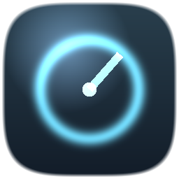
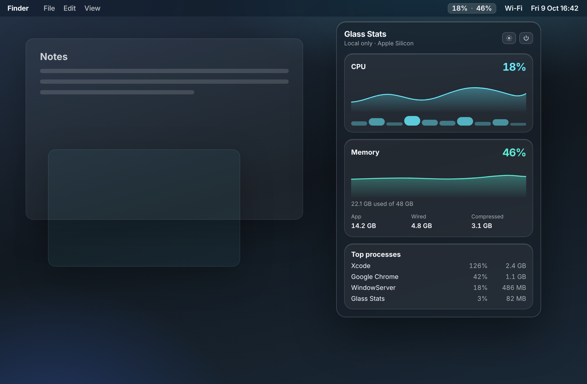
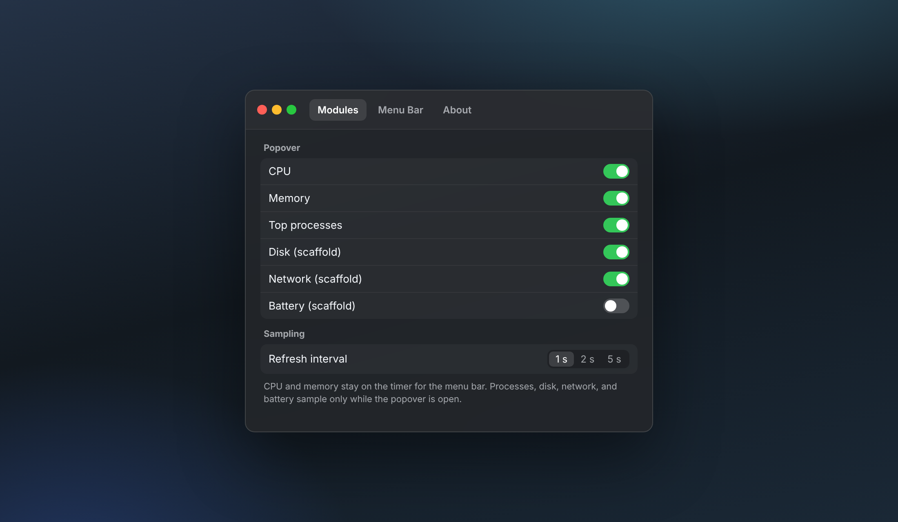

<p align="center">
  
</p>

# Glass Stats

A native **macOS menu bar** monitor for Apple Silicon. CPU and memory sit in the menu bar. Click once for a glass popover with charts, the processes using the machine, and a quick read on disk, network, and battery.

Local only. No ads, no tracking, no account.

**Not affiliated with [Stats](https://mac-stats.com/) / exelban.** Independent app. No Stats trademarks, assets, or code.

<p align="center">
  
</p>

<p align="center"><em>Interface preview of the V1 layout. On your Mac the figures are live samples, not this illustration.</em></p>

## Why it’s worth opening

- **One glance in the menu bar.** Short percents (`18% · 46%`). VoiceOver still says CPU and memory. No Dock icon.
- **A popover you can actually read.** Charts for CPU and RAM, per-core bars, and the top processes. Scrolls instead of running off the screen.
- **Numbers you can compare with Activity Monitor.** CPU is a Mach tick delta, lightly smoothed. Process CPU is one core (about 100% for a full core). Memory used skips the file cache, so an idle Mac does not read as full.
- **Modules you can turn off.** Hide disk, network, battery, or the process list. Those heavier reads run only while the popover is open.
- **Stays on the machine.** No analytics SDK and no network client.

GPU, fans, and sensors are **V1.1** — not in this build, and the app does not call private SMC APIs.

<p align="center">
  
</p>

## Build and run

| | |
| --- | --- |
| Mac | Apple Silicon (`arm64` only) |
| Run on | **macOS 14.0** or later |
| Liquid Glass | **macOS 26** when built with Xcode 26. Older OS uses `.ultraThinMaterial` |
| Xcode | **16** or later. Xcode **26** recommended |
| Signing | Your Apple Development team |

1. Clone and open **`GlassStats.xcodeproj`**. Use the shared **GlassStats** scheme.
2. Target **GlassStats** → **Signing & Capabilities** → choose your **Team**. Leave the App Sandbox **off**.
3. Destination: **My Mac**.
4. **Run** (⌘R). Look in the **menu bar** for the percents. There is no Dock icon.
5. Click the status item for charts and processes. The gear opens Settings.
6. Quit from the power button in the popover, or from Activity Monitor.

**macOS Tahoe** may need **System Settings → Menu Bar** before the icon is allowed to show (sometimes under Desktop & Dock).

Sampling defaults to **1 second** (Settings: 1 / 2 / 5 s). Optional regenerate: `xcodegen generate` from [`project.yml`](project.yml). You do not need XcodeGen to build.

**Deployment target:** macOS 14.0. **Bundle ID:** `com.hkclaw.GlassStats`. **Version:** 0.1.0.

## What is measured

| Module | V1 | Where the number comes from |
| --- | --- | --- |
| CPU | Live | `host_statistics(HOST_CPU_LOAD_INFO)` for the total, `host_processor_info` for each core. Busy time is the delta of user + system + nice over all ticks. The menu bar total is lightly smoothed. |
| Memory | Live | `host_statistics64(HOST_VM_INFO64)` and `hw.memsize`. Used ≈ app (internal − purgeable) + wired + compressed. File cache is excluded. |
| Top processes | Live, popover only | `proc_listpids` and `proc_pidinfo`. Names are resolved for the top 8. CPU is one core, like Activity Monitor, capped at the logical CPU count. |
| Disk | Basic | Boot volume capacity from URL resource values. |
| Network | Basic | `getifaddrs` byte counters, shown per second. |
| Battery | Basic | IOKit power sources. Desktops say there is no internal battery. |
| GPU / fans / sensors | V1.1 | Not implemented. |

The first tick can show “—” because utilization is the difference between two samples. Open the popover to start process, disk, network, and battery reads.

## Permissions

- No Accessibility, Screen Recording, Full Disk Access, or Location prompt for V1 CPU and RAM.
- **App Sandbox is off** so the app can list other processes and read host Mach stats the way a local utility does.
- Hardened Runtime is on. Sign with your Development team.
- **Open at Login** uses `SMAppService`. macOS may require the app to live in `/Applications` before that sticks.

## Project layout

```
GlassStats.xcodeproj/     Checked-in Xcode project
project.yml               Optional XcodeGen spec
GlassStats/               App, sampling, and SwiftUI
docs/images/              README interface previews
scripts/previews/         HTML used to render those previews
LICENSE                   MIT
```

Regenerate the pictures with `scripts/render_previews.sh` (Chrome). They are layout previews, not a capture from a running Mac.

## Disclaimer

Glass Stats is an independent, self-developed utility. It is **not** a fork of Stats, **not** affiliated with exelban, and **not** associated with [mac-stats.com](https://mac-stats.com/). “Stats” is used only to name the product this project is inspired by.

## License

[MIT](LICENSE) © 2026 hkclaw.
